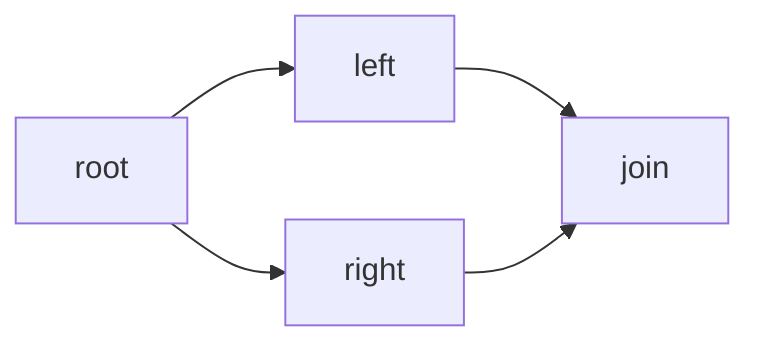

# DAG dependencies: beginner walkthrough

A DAG is a **directed acyclic graph**. Here, a graph is a collection of tasks connected by dependencies. Directed means the arrows have a direction. Acyclic means following the arrows can never take you back to where you started.

Previously, workflows could only be chains. Now they can branch and join:



Both branches need `root`. `join` needs **both** branches to succeed. Multiple roots and independent groups of tasks are also allowed. The worker still executes one task at a time, with the same 250 ms delay. Parallel execution is the next feature.

## JSON and ordering

The task format is unchanged. A join declares `"dependsOn": ["left", "right"]`. Tasks with no parents start `READY`; others start `PENDING`. Submit tasks in any order: the validator saves an order where parents appear before children. Roots enter a FIFO queue in submitted order, and children enter it when all their parents have been ordered. This is deterministic for a given definition, although independent tasks can have several valid orders.

## What changed in the code

### WorkflowValidator: order tasks and reject cycles

`validateAndOrder()` builds a map from task IDs to definitions. It rejects duplicate IDs, missing parents, self-dependencies, duplicate parents, and unknown task types.

It then uses **Kahn's algorithm**:

1. Count each task's parents: `root=0`, `left=1`, `right=1`, `join=2`.
2. Put tasks with zero parents into a queue. Initially, that is `root`.
3. Take a task from the queue and add it to the ordered result. Reduce its children's remaining-parent counts.
4. When a child's count reaches zero, add it to the queue.
5. If some tasks never enter the result, there is a cycle: reject the definition with HTTP 400.

These counters validate the definition. During execution, dependency decisions use task states saved in PostgreSQL.

### WorkflowValidator: validate output references

An **ancestor** is a task you reach by following dependencies backwards. `join` has ancestors `left`, `right`, and `root`. It may reference their complete outputs using `$ref`.

`right` may read `root.output`. It cannot read `left.output` unless it also declares `left` as a dependency. Being earlier in the array is insufficient. References to siblings, independent components, descendants, or the task itself are rejected. References do not add dependencies automatically. `run.input` remains valid for every task.

### ExecutionService: wait for every parent

After saving a task's success, `succeed()` reads the task states and builds a set of successful task keys. A pending task becomes ready only if this check passes:

```java
succeeded.containsAll(t.dependsOn())
```

After `left` succeeds, the set lacks `right`, so `join` stays `PENDING`. After `right` succeeds, both keys are present, so `join` becomes `READY`. `claimNext()` checks prerequisites again before starting a ready task.

Completion, readiness changes, and history are saved in one transaction. If a write fails, all those changes roll back. The existing run creation code already handles multiple roots, and dependency arrays already fit the stored JSON; no new API or migration is needed.

## Failure and completion

A run succeeds only when all its tasks succeed, including independent components. Under the current stop-on-failure policy, a failure skips **all unstarted tasks in the run**, including ready independent branches. In the failing example, expect `SUCCEEDED`, `FAILED`, `SKIPPED`, `SKIPPED`. The join never gets an attempt.

## Try it

Start the database and app using the README. Reimport the [Postman collection](../examples/postman/DurableFlow.postman_collection.json), then run the **DAG walkthrough** folder in order. Repeat **Get DAG run** until it is `SUCCEEDED`; inspect the join attempt to see its resolved input. **DAG failure walkthrough** demonstrates the stop policy. Each folder saves separate IDs and creates a unique workflow name.

Or submit [diamond-dag.json](../examples/workflows/diamond-dag.json) from PowerShell:

```powershell
$baseUrl = 'http://127.0.0.1:8080'
$workflow = Invoke-RestMethod -Method Post -Uri "$baseUrl/workflows" -ContentType 'application/json' -Body (Get-Content 'examples/workflows/diamond-dag.json' -Raw)
$run = Invoke-RestMethod -Method Post -Uri "$baseUrl/workflows/$($workflow.id)/runs" -ContentType 'application/json' -Body (Get-Content 'examples/workflows/run-input.json' -Raw)
Invoke-RestMethod "$baseUrl/runs/$($run.id)" | ConvertTo-Json -Depth 30
```

Repeat the GET until terminal. The join output contains `left`, `right`, and `original`, with the branch outputs including the original run input. Then read the tasks and join attempt:

```powershell
$tasks = Invoke-RestMethod "$baseUrl/runs/$($run.id)/tasks"
$join = $tasks | Where-Object taskKey -eq 'join'
Invoke-RestMethod "$baseUrl/tasks/$($join.id)/attempts" | ConvertTo-Json -Depth 30
```

Use [failing-dag.json](../examples/workflows/failing-dag.json) for failure. Example files use fixed names/version 1; reuse saved workflow IDs or change the name/version when repeating them. All six business APIs and three health endpoints remain available, and existing chains still work. Saved state survives restart. Interrupted `RUNNING` attempts still await the later lease recovery feature.
