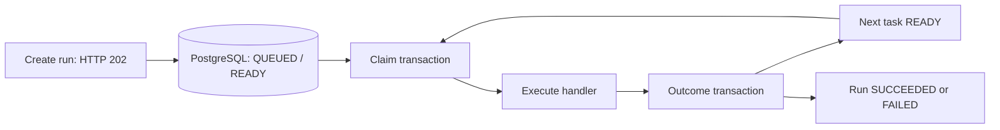

# Sequential execution walkthrough

DurableFlow now executes a workflow with DAG dependencies in the background. One application contains the HTTP API, a database polling loop, and one worker. PostgreSQL stores the complete execution state. Kafka is introduced in a later feature.

## What happens after creating a run

1. `POST /workflows/{id}/runs` commits a queued run, its task records, and initial history events. It returns HTTP 202 with the initial snapshot.
2. The worker polls for a run containing a `READY` task, approximately every 250 ms while idle. It processes one task per poll; the delay starts after the previous task finishes.
3. A short database transaction locks the run, checks that all its dependencies succeeded and no task in that run is already running, and creates attempt 1. The run/task become `RUNNING`. PostgreSQL `FOR UPDATE SKIP LOCKED` prevents competing claims from taking the same run. The transaction commits before the handler executes.
4. The handler receives resolved input. References read this run's stored input and successful upstream outputs. Literal data containing `$ref` is preserved without being interpreted again.
5. Another transaction locks the run and verifies that this task and attempt are still running. It saves the outcome and history together. Repeating a completion cannot replace a terminal result.
6. Success makes any pending task whose parents have all succeeded `READY`. When every task succeeds, the run becomes `SUCCEEDED`. Failure marks the task/attempt `FAILED`, skips unstarted tasks, and marks the run `FAILED`.



Handler execution holds no database transaction or row lock. Each attempt saves its actual resolved input, output, start/end timestamps, and error type/message. Task `input` remains the original template so references remain visible. Run reads use a consistent database snapshot for the run and its tasks.

The console prints structured fields including `runId`, `taskId`, and `attemptId` for task starts and outcomes. Execution transition events are persisted; an API for browsing those events comes later.

## Built-in handlers

| Type | Input | Result |
| --- | --- | --- |
| `echo` | Any JSON object | Returns the resolved input object |
| `sleep` | Optional `millis`: integer from 0 to 60000; default 1000 | Waits, then returns the resolved input object |
| `fail` | Optional `message`: string; default `Simulated task failure` | Throws `DEMO_FAILURE` with that message |

Invalid handler input produces a failed attempt with `INVALID_INPUT`. Handler-specific validation happens during execution because input can depend on run input or upstream results. The sleep bound is a demo handler constraint; general task timeouts arrive later. Tasks get one attempt in this feature; automatic retries arrive later.

## Try success and failure

Start PostgreSQL and the application:

```powershell
docker compose up -d --wait postgres
.\mvnw.cmd spring-boot:run
```

In a second PowerShell terminal, submit the success example and wait for completion:

```powershell
$baseUrl = 'http://127.0.0.1:8080'
$workflow = Invoke-RestMethod -Method Post -Uri "$baseUrl/workflows" -ContentType 'application/json' -Body (Get-Content 'examples/workflows/three-task-chain.json' -Raw)
$run = Invoke-RestMethod -Method Post -Uri "$baseUrl/workflows/$($workflow.id)/runs" -ContentType 'application/json' -Body (Get-Content 'examples/workflows/run-input.json' -Raw)
$deadline = (Get-Date).AddSeconds(30)
do {
    Start-Sleep -Milliseconds 250
    $result = Invoke-RestMethod -Uri "$baseUrl/runs/$($run.id)"
} while ($result.status -in @('QUEUED', 'RUNNING') -and (Get-Date) -lt $deadline)
$result | ConvertTo-Json -Depth 20
```

Expect `SUCCEEDED` and three successful tasks. `prepare` outputs `{"message":"Hello DurableFlow"}`, `format` wraps it in `previous`, and `save` wraps that output again. If the loop reaches its deadline, inspect the current status and worker logs.

Read tasks and the final attempt:

```powershell
$tasks = Invoke-RestMethod -Uri "$baseUrl/runs/$($run.id)/tasks"
$tasks | Select-Object taskKey, status, startedAt, finishedAt
Invoke-RestMethod -Uri "$baseUrl/tasks/$($tasks[-1].id)/attempts" | ConvertTo-Json -Depth 20
```

Submit the failure example:

```powershell
$failureWorkflow = Invoke-RestMethod -Method Post -Uri "$baseUrl/workflows" -ContentType 'application/json' -Body (Get-Content 'examples/workflows/failing-chain.json' -Raw)
$failureRun = Invoke-RestMethod -Method Post -Uri "$baseUrl/workflows/$($failureWorkflow.id)/runs" -ContentType 'application/json' -Body '{}'
$deadline = (Get-Date).AddSeconds(30)
do {
    Start-Sleep -Milliseconds 250
    $failure = Invoke-RestMethod -Uri "$baseUrl/runs/$($failureRun.id)"
} while ($failure.status -in @('QUEUED', 'RUNNING') -and (Get-Date) -lt $deadline)
$failure.tasks | Select-Object id, taskKey, status
Invoke-RestMethod -Uri "$baseUrl/tasks/$($failure.tasks[1].id)/attempts" | ConvertTo-Json -Depth 20
```

Expect run `FAILED`, task states `SUCCEEDED`, `FAILED`, `SKIPPED`, and error type `DEMO_FAILURE` with message `Demo formatting failure`. The skipped task has no start time or attempts; its finish time records when it was skipped.

The example files have fixed names/version 1. Reuse saved workflow IDs or change the name/version if they already exist. The [Postman collection](../examples/postman/DurableFlow.postman_collection.json) uses unique names, includes success/failure folders, and captures IDs automatically. Repeat **Get run** or **Get failed run** until the run is terminal; immediate reads may show `QUEUED` or `RUNNING`.

## Restart and configuration

Restart the application and read the same run/task IDs: results and attempts remain saved. To demonstrate recovery of unstarted work:

1. Stop the app. Set `$env:EXECUTION_ENABLED = 'false'` and start it again.
2. Submit a new run. It stays `QUEUED` while the worker is disabled.
3. Stop the app, run `Remove-Item Env:EXECUTION_ENABLED`, and restart it.
4. Read the saved run ID until it completes. The worker discovers its persisted `READY` task.

| Environment variable | Default | Purpose |
| --- | --- | --- |
| `EXECUTION_ENABLED` | `true` | Enable the background worker; `false` keeps create/read APIs available |
| `EXECUTION_POLL_DELAY_MS` | `250` | Positive delay in milliseconds between task executions/polls |

Use one enabled application process for this milestone. Multiple workers, leases, heartbeats, and automatic recovery are later features. A crash or interruption during handler execution, or a failure while saving its outcome, can leave a task/attempt `RUNNING`; this version does not reclaim that task automatically. A run whose active attempt is stranded cannot progress. Completed tasks are preserved, and work that remained `READY` is picked up after restart.

Flyway migration V2 adds indexes for polling; it preserves the V1 tables and saved records. Current tests cover actual background execution through HTTP, reference resolution, dependency ordering, one-attempt claims, competing claims, duplicate completions, stop-on-failure, and rollback of failed claim/completion writes.
